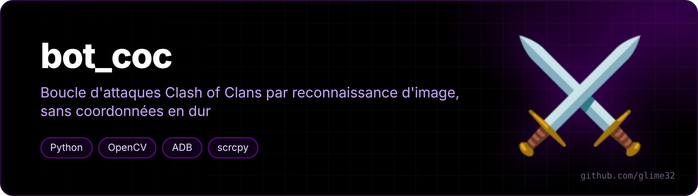
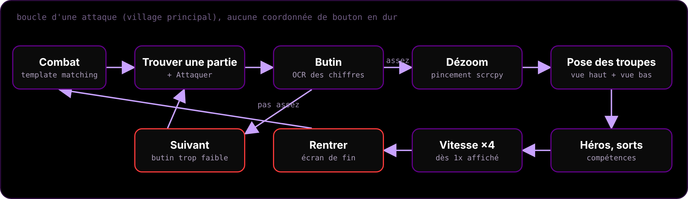
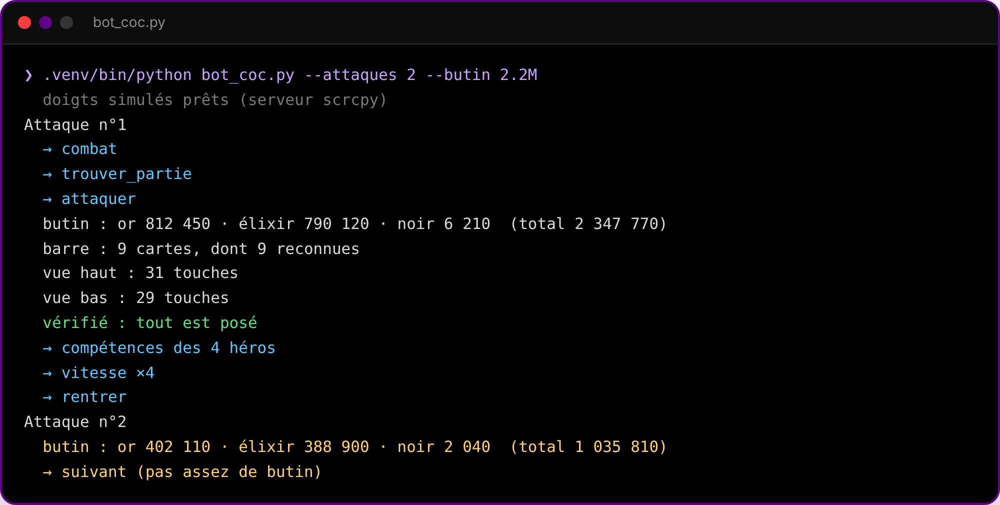
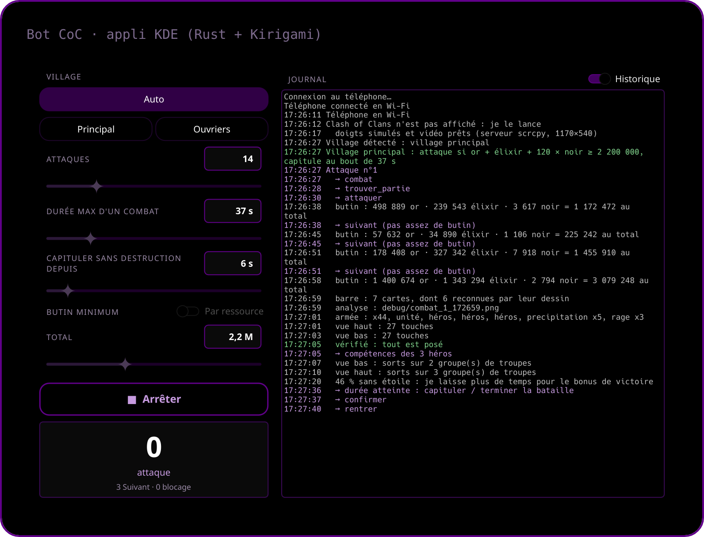

<p align="center"></p>

<p align="center">   </p>

<p align="center"><a href="README.md">🇬🇧 English version</a></p>

**Une boucle d'attaques Clash of Clans par reconnaissance d'image** : le téléphone est piloté par ADB, OpenCV trouve les boutons à l'écran, et aucune coordonnée de bouton n'est écrite en dur.

> [!WARNING]
> Automatiser le jeu est contraire aux conditions d'utilisation de Supercell, qui fait des vagues de bannissement contre les bots. À utiliser sur un compte que tu es prêt à perdre. C'est un projet perso de vision par ordinateur, partagé pour apprendre.

<p align="center"></p>

## Comment ça marche

- **Vision** : l'écran arrive en vidéo h264 depuis le serveur scrcpy, décodée avec PyAV : une image fraîche en ~50 ms au lieu de ~1,5 s par `adb screencap` (gardé en secours). Chaque bouton est cherché par template matching OpenCV avec vérification de la couleur et du contraste (`templates/`) ; il n'est touché que s'il est vu au même endroit sur deux images de suite, pour ne pas se faire piéger par les animations des menus. Taille et place des boutons trouvés sont retenues.
- **Rendu à 50 %** : le jeu est passé en résolution 50 % (`cmd game set --downscale 0.5`) et y reste ; tous les templates sont faits pour ça.
- **Doigts** : le serveur officiel de [scrcpy](https://github.com/Genymobile/scrcpy) (fourni dans `outils/`, Apache-2.0) est envoyé sur le téléphone et piloté directement : vrai pincement à deux doigts pour dézoomer (sans root), touches et glissements rapides. Repli sur `adb input` si besoin.
- **Lecture des chiffres** : un petit OCR sur les chiffres du jeu pour lire le butin et les compteurs de troupes. Il passe les villages sous un seuil : soit le total (`--butin`, or + élixir + 120 × élixir noir), soit un minimum par ressource (`--or`, `--elixir`, `--noir`, une ou plusieurs, toutes doivent être atteintes).
- **Déploiement** : les cartes de la barre sont reconnues quel que soit le décor (les nouvelles sont apprises toutes seules) ; les bords de la carte sont cherchés une fois puis gardés dans `templates/carte.json` ; troupes, héros et engin sont posés le long des bords, puis vérifiés et reposés jusqu'à ce que tout soit sorti. La position de la caméra est mesurée à chaque attaque, car le jeu la décale jusqu'à ~180 px.
- **Sorts** : lancés une fois toutes les troupes sorties, pendant le combat, sur les groupes de troupes qui bougent le plus (trois images vidéo à 0,12 s d'écart, comparées en quart de résolution) : la moitié depuis la vue du bas, le reste depuis la vue du haut. Chaque carte de la barre est vérifiée, pour ne jamais poser un sort comme une troupe.
- **Fin de combat** : le bot capitule quand les « Dégâts généraux » ne bougent plus depuis 6 s (`--fige`, et au moins 20 s après le début de la pose), ou quand la durée `--duree` est passée, au lieu d'attendre la fin du chrono. À partir de 46 % sans étoile, il laisse plus de temps (délai doublé, durée + 15 s) pour aller chercher l'étoile et le bonus de victoire : les étoiles sont lues en bas à droite de l'écran.
- **Fenêtres imprévues** : les boutons de `templates/popups/` (OK, croix…) sont touchés quand une fenêtre inattendue apparaît. Le « Rentrer » de l'écran de recherche d'adversaire n'en fait pas partie (il annulait chaque recherche) : il n'est touché que si l'écran est figé depuis 25 s.
- **Léger pour le PC** : la vidéo est décodée à 10 images/s (environ 5 % d'un cœur en attente), et le bot tourne sur les cœurs économes d'un processeur Intel hybride (trouvés tout seuls, réglage `COEURS` en haut du script), jamais sur le premier cœur. Le serveur adb est déplacé sur les mêmes cœurs.
- **Câble ou Wi-Fi** : le bot prend le téléphone branché en USB, sinon celui connecté en Wi-Fi (`adb connect`), avec une vidéo moins lourde (4 Mbit/s). Si la liaison Wi-Fi tombe, il la refait avec un script `adb-a54` s'il en trouve un.
- **Mode auto** (`--auto`) : au lancement, il regarde l'écran et choisit tout seul entre le village principal et la base des ouvriers. Si Clash of Clans n'est pas au premier plan, il le lance.
- **Base des ouvriers** (`--nuit`) : deux étapes, pose tout autour de la base adverse, compétence de chaque camp 5 s après sa pose, compétence du héros dès que sa jauge est pleine, et bouton ×4 touché seulement quand il affiche 1×. Chaque combat y est joué jusqu'au bout : `--duree` et `--fige` ne valent que pour le village principal, même en mode auto.

<p align="center"><br><sub>exemple de sortie</sub></p>

## Installation

```bash
git clone https://github.com/glime32/bot-coc && cd bot-coc
./install.sh                       # crée .venv avec opencv-python, numpy et PyAV
```

Il faut `adb` et un téléphone Android avec le **débogage USB** (ou le débogage sans fil, déjà connecté avec `adb connect`). Les templates fournis viennent d'un jeu en français en 2340×1080 ; pour une autre langue ou un autre écran, refais-les avec `capture NOM`.

## Commandes

```bash
.venv/bin/python bot_coc.py                  # village principal, boucle sans fin (Ctrl+C)
.venv/bin/python bot_coc.py --nuit           # base des ouvriers
.venv/bin/python bot_coc.py --auto           # village principal ou base des ouvriers, vu à l'écran
.venv/bin/python bot_coc.py --attaques 1     # une seule attaque pour vérifier
.venv/bin/python bot_coc.py --duree 90       # capitule au bout de 90 s de combat
.venv/bin/python bot_coc.py --fige 10        # capitule après 10 s sans destruction (0 = jamais)
.venv/bin/python bot_coc.py --butin 3M       # attaque seulement si le butin ≥ 3 millions
.venv/bin/python bot_coc.py --or 1M --noir 8000   # or ≥ 1 million et élixir noir ≥ 8 000
.venv/bin/python bot_coc.py --butin 0        # aucun minimum : attaque le premier village
.venv/bin/python bot_coc.py test             # analyse l'écran actuel -> debug/
.venv/bin/python bot_coc.py capture NOM      # crée templates/NOM.png (tu encadres le bouton)
.venv/bin/python bot_coc.py chiffres         # réapprend les chiffres sur ton écran
.venv/bin/python bot_coc.py recalibrer       # recherche les bords de la carte au prochain combat
```

## Appli KDE

<p align="center"></p>

Une fenêtre pour lancer et suivre le bot sans terminal (Rust + [cxx-qt](https://github.com/KDAB/cxx-qt) + Kirigami) :

- **Réglages** : village (auto, principal ou base des ouvriers), nombre d'attaques, durée max d'un combat, délai sans destruction avant de capituler, butin minimum (total, ou or / élixir / élixir noir au choix). Ils sont retenus d'une fois sur l'autre.
- **Suivi** : journal en direct en couleurs (ou seulement l'étape en cours), compteurs d'attaques, de « Suivant » et de blocages, notification à la fin ou en cas de blocage.
- **Téléphone** : sans câble, elle le connecte en Wi-Fi à l'ouverture avec un script `adb-a54` s'il existe, et le déconnecte à la fermeture.
- **Arrêt propre** : fermer la fenêtre arrête le bot. Le journal est suivi par inotify : aucun réveil tant que le bot se tait.

```bash
sudo pacman -S rust qt6-declarative kirigami qqc2-breeze-style   # Arch / CachyOS
cd appli && ./installer.sh        # compile et ajoute « Bot CoC » au menu des applications
```

## Appli Android

Le même bot, réécrit en Java, qui tourne **sur le téléphone lui-même** : plus besoin du PC ni d'adb pendant les attaques (dossier `android/`).

- **Vision** : le partage d'écran d'Android (MediaProjection) en demi-résolution, une image fraîche seulement quand le bot en demande une, et rien du tout quand il est arrêté. OpenCV pour Android (seulement la partie arm64, ~10 Mo, téléchargée par `build.sh`). Comme `matchTemplate` n'y utilise qu'un cœur, la recherche d'un bouton passe d'abord au quart de la résolution, puis affine autour des meilleurs endroits, en essayant les tailles en parallèle.
- **Doigts** : un service d'accessibilité (touches par paquets, glissements, pincement à deux doigts). Le bot ne touche que Clash of Clans : si une autre appli, le volet des notifications ou l'écran de verrouillage passe devant, il se met en pause.
- **Pastille** par-dessus le jeu, en haut au centre : attaque en cours et état. Touchée, elle ouvre un panneau avec Lancer / Arrêter, les compteurs et les dernières lignes du journal. Arrêt aussi par la notification ou par un appui long sur volume bas.
- **Batterie** : écran au minimum pendant que le bot joue, partage d'écran en veille dès qu'il s'arrête, service d'accessibilité coupé 2 min après avoir quitté le jeu et rallumé au lancement suivant.
- **Réglages** : les mêmes que l'appli KDE, dans l'appli « Bot CoC ». Village principal et base des ouvriers, comme le bot du PC.

```bash
cd android && ./build.sh            # SDK Android (build-tools et plateforme 36) + Java 21, sans Gradle
adb install -r build/bot-coc.apk
# une seule fois, pour ne plus jamais avoir de fenêtre d'autorisation :
adb shell appops set fr.glime.botcoc PROJECT_MEDIA allow                      # partage d'écran sans question
adb shell pm grant fr.glime.botcoc android.permission.WRITE_SECURE_SETTINGS   # l'appli rallume son accessibilité
# facultatif : jeu en 50 % et 30 images/s dans le mode « batterie » que Game Booster remet à chaque lancement
adb shell cmd game set --mode 3 --downscale 0.5 --fps 30 com.supercell.clashofclans
```

Ouvre ensuite l'appli « Bot CoC », règle-la et touche « Lancer » : elle ouvre le jeu, la pastille et lance les attaques.

Outil de fan, ni affilié ni approuvé par Supercell.
