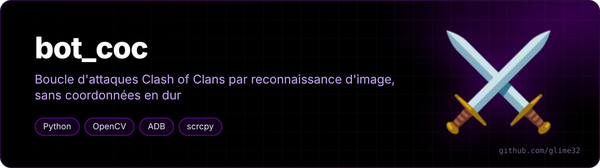
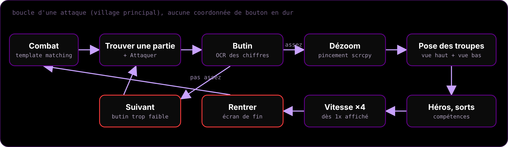
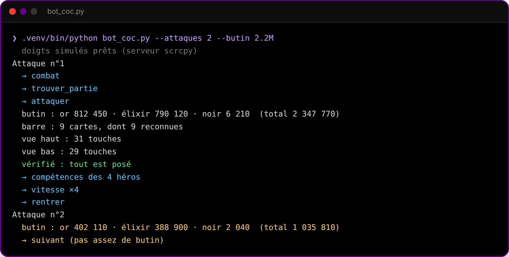
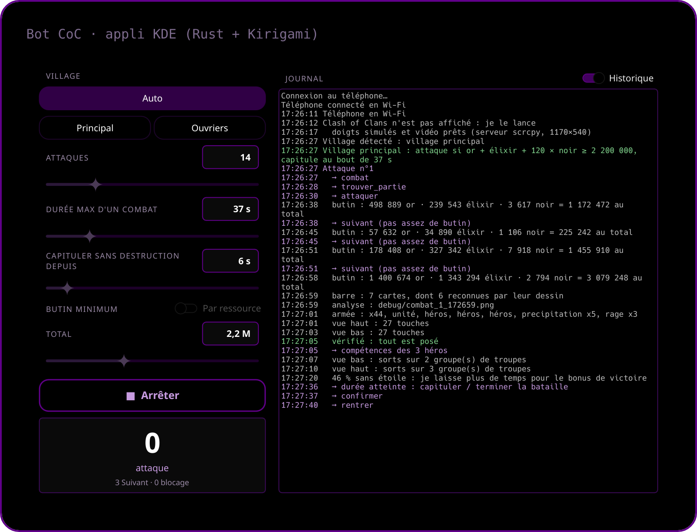

<p align="center"></p>

<p align="center">   </p>

<p align="center"><a href="README.fr.md">🇫🇷 Version française</a></p>

**A Clash of Clans attack loop driven by image recognition** — the phone is controlled over ADB, OpenCV finds the buttons on screen, and no button coordinate is hard-coded.

> [!WARNING]
> Automating the game is against Supercell's Terms of Service, and Supercell runs ban waves against bots. Use it on an account you're ready to lose. This is a personal computer-vision project, shared for learning.

<p align="center"></p>

## How it works

- **Vision**: the screen arrives as a live h264 stream from the scrcpy server, decoded with PyAV: a fresh frame in ~50 ms instead of ~1.5 s for `adb screencap` (which stays as a fallback). OpenCV template matching with color/contrast checks for every button (`templates/`); a button is only tapped once it is seen at the same place on two frames in a row, so menu animations don't fool it. Sizes and positions found are remembered.
- **50 % render**: the game is switched to 50 % resolution (`cmd game set --downscale 0.5`) and left there; every template is tuned for it.
- **Fingers**: the official [scrcpy](https://github.com/Genymobile/scrcpy) server (bundled in `outils/`, Apache-2.0) is pushed to the phone and driven directly: real two-finger pinch to zoom out (no root), fast taps and swipes. Falls back to `adb input` if needed.
- **Reading numbers**: a tiny OCR on the game's own digit glyphs to read loot and troop counts — skips villages below a loot threshold: either the total (`--butin`, gold + elixir + 120 × dark elixir) or a minimum per resource (`--or`, `--elixir`, `--noir`, one or several, all of them must be met).
- **Deployment**: troop bar cards are recognized whatever the background (new cards are learned automatically); the map edges are probed once then saved in `templates/carte.json`; troops, heroes and siege machine are placed along the edges, then checked and redeployed until everything is out. The camera position is measured on every attack, since the game shifts it by up to ~180 px.
- **Spells**: cast once every troop is out, during the battle, on the troop groups that move the most (three video frames 0.12 s apart, compared at quarter resolution): half from the bottom view, the rest from the top view. Every bar card is checked so a spell is never dropped as a troop.
- **End of battle**: the bot surrenders when "Overall damage" hasn't changed for 6 s (`--fige`, and at least 20 s after deployment started), or once the `--duree` time is up, instead of waiting for the timer. From 46 % with no star yet, it gives the attack more time (doubled delay, duration + 15 s) to reach the star and the victory bonus: stars are read in the bottom-right corner of the screen.
- **Surprise pop-ups**: buttons in `templates/popups/` (OK, close…) are tapped when an unexpected window shows up. The "Rentrer" button of the opponent search screen is not one of them (it cancelled every search): it is only tapped after the screen has been frozen for 25 s.
- **Light on the PC**: video is decoded at 10 fps (about 5 % of one core while waiting), and the bot runs on the efficiency cores of a hybrid Intel CPU (found automatically, `COEURS` setting at the top of the script), never on the first core. The adb server is moved to the same cores.
- **USB or Wi-Fi**: the bot uses the phone plugged in over USB, otherwise the one connected over Wi-Fi (`adb connect`), with a lighter video stream (4 Mbit/s). If the Wi-Fi link drops, it reconnects with an `adb-a54` script when one is installed.
- **Auto mode** (`--auto`): at startup it looks at the screen and picks the home village or the Builder Base by itself. If Clash of Clans isn't in the foreground, it launches it.
- **Builder Base** (`--nuit`): two stages, deploys all around the enemy base, triggers each camp's ability 5 s after it lands, the hero ability whenever its gauge is full, and taps the ×4 speed button only when it shows 1×.

<p align="center"><br><sub>example output</sub></p>

## Install

```bash
git clone https://github.com/glime32/bot-coc && cd bot-coc
./install.sh                       # creates .venv with opencv-python, numpy and PyAV
```

Needs `adb` and an Android phone with **USB debugging** on (or wireless debugging, already connected with `adb connect`). The bundled templates were captured on a French-language game at 2340×1080; for another language or screen, recreate them with `capture NOM`.

## Commands

```bash
.venv/bin/python bot_coc.py                  # main village, endless loop (Ctrl+C to stop)
.venv/bin/python bot_coc.py --nuit           # Builder Base
.venv/bin/python bot_coc.py --auto           # home village or Builder Base, read from the screen
.venv/bin/python bot_coc.py --attaques 1     # a single attack to check
.venv/bin/python bot_coc.py --duree 90       # surrender after 90 s of battle
.venv/bin/python bot_coc.py --fige 10        # surrender after 10 s without new damage (0 = never)
.venv/bin/python bot_coc.py --butin 3M       # attack only if loot ≥ 3 million
.venv/bin/python bot_coc.py --or 1M --noir 8000   # gold ≥ 1 million and dark elixir ≥ 8,000
.venv/bin/python bot_coc.py --butin 0        # no minimum: attack the first village
.venv/bin/python bot_coc.py test             # analyze the current screen -> debug/
.venv/bin/python bot_coc.py capture NOM      # create templates/NOM.png (frame the button)
.venv/bin/python bot_coc.py chiffres         # re-learn the digits on your screen
.venv/bin/python bot_coc.py recalibrer       # probe the map edges again next battle
```

## KDE app

<p align="center"></p>

A window to start and watch the bot without a terminal (Rust + [cxx-qt](https://github.com/KDAB/cxx-qt) + Kirigami, French UI):

- **Settings**: village (auto, home village or Builder Base), number of attacks, max battle time, delay without new damage before surrendering, minimum loot (total, or any choice of gold / elixir / dark elixir). They are remembered between runs.
- **Monitoring**: live colored log (or just the current step), attack / "Next" / stuck counters, a notification when it finishes or gets stuck.
- **Phone**: without a cable, it connects the phone over Wi-Fi on startup with an `adb-a54` script when one exists, and disconnects it on exit.
- **Clean stop**: closing the window stops the bot. The log is followed with inotify: no wake-ups while the bot is quiet.

```bash
sudo pacman -S rust qt6-declarative kirigami qqc2-breeze-style   # Arch / CachyOS
cd appli && ./installer.sh        # builds it and adds "Bot CoC" to the application menu
```

Fan-made, not affiliated with or endorsed by Supercell.
